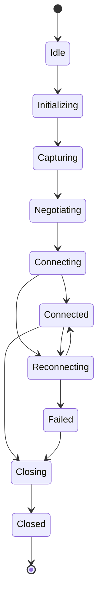

# Daglei TV — Cross-Browser WebRTC Engineering Plan

**Document type:** Architecture review and engineering plan  
**Status:** Proposed — validate against the repository before implementation  
**Prepared:** 24 November 2026  
**Primary objective:** Make Daglei TV work reliably across independent browser engines, while treating Ladybird as an experimental compatibility target.

---

## 1. Executive summary

Daglei TV is reported to use:

- **Frontend:** Next.js, React, TypeScript
- **Media API:** Native WebRTC (`RTCPeerConnection`)
- **Media topology:** Peer-to-peer (P2P)
- **Signaling hosting:** Render
- **TURN provider:** Cloudflare
- **Compatibility goal:** Modern browsers, including experimental support for Ladybird

The recommended direction is to **keep the existing technology choices initially**. Native WebRTC is a reasonable choice when the application needs direct control over capture, negotiation, ICE, tracks, and diagnostics. P2P is also reasonable for one-to-one sessions and small rooms.

The main engineering improvement should be separation of concerns:

1. Keep React components focused on presentation and user interaction.
2. Put room/session orchestration in an application layer.
3. Put screen capture and media-track lifecycle in a capture layer.
4. Put `RTCPeerConnection`, SDP, ICE, and codec handling in a transport layer.
5. Put capability checks and compatibility policy in a compatibility layer.
6. Put connection metrics and troubleshooting in a diagnostics layer.
7. Keep signaling and TURN infrastructure concerns out of UI components.

The guiding principle is:

> Build against web-platform capabilities and standards, not against a browser's brand name or user-agent string.

This plan is a target architecture, not a claim that the current code already has these properties. The repository must be inspected before any refactor is designed or applied.

## 2. Known facts, assumptions, and items to verify

| Item | Current understanding | Verification needed |
|---|---|---|
| Frontend | Next.js + React + TypeScript | Confirm Next.js version, router, rendering strategy, and project conventions |
| WebRTC | Native `RTCPeerConnection` | Locate all peer-connection creation, signaling, capture, and cleanup code |
| Topology | P2P | Confirm whether each broadcaster creates one peer connection per viewer, whether rooms are full mesh, or whether another topology is used |
| Signaling | Hosted on Render | Confirm implementation, protocol (likely WebSocket, but do not assume), room state location, auth, and deployment scaling |
| TURN | Cloudflare | Confirm that this is Cloudflare Realtime TURN and inspect the actual credential-generation flow without exposing secrets |
| Screen capture | Likely `getDisplayMedia()` | Confirm API and constraints used; test audio capture separately |
| Ladybird | Experimental target | Test actual installed build and platform; do not infer WebRTC support from browser-engine status |

The word “Render” is used here for the hosting service. The exact signaling design and the exact Cloudflare TURN product/configuration remain repository and deployment audit items.

## 3. Browser-engine landscape

Browsers with different names do not necessarily use different rendering engines.

| Browser | Main engine family | JavaScript engine | Daglei TV testing role |
|---|---|---|---|
| Google Chrome | Chromium / Blink | V8 | Baseline Chromium test |
| Microsoft Edge | Chromium / Blink | V8 | Separate branded-browser validation |
| Brave | Chromium / Blink | V8 | Validate Brave Shields/privacy behavior as well as Chromium baseline |
| Firefox | Gecko | SpiderMonkey | Independent-engine compatibility target |
| Safari | WebKit | JavaScriptCore | Independent-engine compatibility target; test real Safari on Apple platforms |
| Ladybird | LibWeb | LibJS | Experimental independent-engine target |

**Important distinctions:**

- Brave is Chromium-based. It is not a separate rendering-engine family, but privacy protections, settings, and release configuration can still affect application behavior.
- Playwright's WebKit build is not the same thing as the branded Safari application. Playwright documents that its WebKit build is derived from the WebKit main branch and that it does not automate branded Safari directly.
- Ladybird is a new, independent browser engine. Its alpha was announced on **23 November 2026** for macOS and Linux. The project says the alpha is incomplete and supports WebDriver. This makes it useful for early compatibility testing, not a browser that should be assumed to have production-level WebRTC support.
- A browser engine's architecture can be studied independently of whether it currently implements every API Daglei TV needs.

### 3.1 The useful mental model

A browser is more than a renderer. A simplified conceptual model includes:

- Browser UI and permission handling
- HTML, CSS, DOM, and rendering implementation
- JavaScript runtime
- Networking and security implementation
- Media capture, encoding, decoding, and playback integration
- Graphics/compositing and platform integration
- Multi-process and sandbox boundaries

These are conceptual responsibilities, not a claim that every browser implements them as separate processes or as one standardized “media engine.” Actual boundaries vary by browser and operating system.

For Daglei TV, the most relevant browser-platform surfaces are:

1. `navigator.mediaDevices.getDisplayMedia()` for display capture.
2. `MediaStream` and `MediaStreamTrack` for captured tracks.
3. `RTCPeerConnection` for WebRTC transport and negotiation.
4. `RTCRtpSender` / codec capabilities for media transmission.
5. `HTMLMediaElement` for remote playback and autoplay behavior.
6. `RTCPeerConnection.getStats()` for diagnostics.

## 4. Proposed Daglei TV architecture

### 4.1 Layer responsibilities

```text
Next.js / React presentation
        |
        v
Application layer
  - room lifecycle
  - participants and permissions
  - session orchestration
  - user-visible status
        |
        +-------------------------+
        |                         |
        v                         v
Capture layer             Compatibility layer
  - display capture         - capability detection
  - optional audio          - support policy
  - track lifecycle         - known workarounds
        |                         |
        +-------------+-----------+
                      |
                      v
               Transport layer
                 - RTCPeerConnection
                 - SDP negotiation
                 - ICE and restart
                 - codec inspection
                 - connection lifecycle
                      |
          +-----------+-----------+
          |                       |
          v                       v
     Signaling layer          Diagnostics
       - Render                 - getStats()
       - SDP/ICE routing        - connection events
       - room messages          - quality metrics
          |
          v
   Shared state / routing (if scaling requires it)

Media path:
  Browser A <------ direct WebRTC or TURN-relayed media ------> Browser B
```

Signaling and media transport are separate paths:

- The signaling service exchanges setup and application messages (for example, SDP and ICE candidates).
- WebRTC media normally travels directly between peers when possible.
- TURN relays media when a direct path cannot be established.
- Render should not be assumed to carry the WebRTC media stream merely because it hosts signaling.

### 4.2 Suggested code organization

Adapt naming to the existing repository rather than forcing this exact tree:

```text
src/
├── app/
├── components/
│   ├── room/
│   ├── participants/
│   └── media/
├── features/
│   └── streaming/
│       ├── application/
│       │   ├── room-service.ts
│       │   └── session-manager.ts
│       ├── capture/
│       │   ├── screen-capture.ts
│       │   ├── audio-capture.ts
│       │   └── track-manager.ts
│       ├── transport/
│       │   ├── peer-connection.ts
│       │   ├── peer-manager.ts
│       │   ├── ice-manager.ts
│       │   └── codec-manager.ts
│       ├── signaling/
│       │   ├── signaling-client.ts
│       │   ├── signaling-protocol.ts
│       │   └── reconnect-manager.ts
│       ├── compatibility/
│       │   ├── capabilities.ts
│       │   └── compatibility-policy.ts
│       ├── diagnostics/
│       │   ├── stats-collector.ts
│       │   └── connection-monitor.ts
│       └── index.ts
└── lib/
    └── logger/
```

Do not create all these files as a speculative refactor. First map the existing code and identify where responsibilities currently live. Create abstractions only where they solve an observed coupling or reliability problem.

### 4.3 Next.js and React constraints

Browser APIs are not available during server-side rendering. Therefore:

- Do not access `window`, `navigator`, `MediaStream`, or `RTCPeerConnection` at module import time in code that can be evaluated on the server.
- Keep browser-dependent behavior behind a client component or client-only module.
- Initialize peer connections in an explicit client lifecycle, not while rendering.
- Start screen capture from a user action, such as a button click. Do not call `getDisplayMedia()` automatically from a mount effect.
- Make cleanup reliable: stop tracks, remove listeners, close peer connections, clear timers, and release references.
- Account for React development Strict Mode and repeated mount/effect cycles; side effects must not create duplicate sessions.

## 5. Capability detection and graceful degradation

### 5.1 Prefer feature detection over browser-name branching

Avoid rules such as:

```ts
if (browser === "Firefox") {
  // Use a different WebRTC implementation.
}
```

Prefer checking the exact API required by a feature:

```ts
export type BrowserCapabilities = {
  secureContext: boolean;
  screenCapture: boolean;
  peerConnection: boolean;
  peerConnectionStats: boolean;
  senderCodecCapabilities: boolean;
};

export function detectBrowserCapabilities(): BrowserCapabilities {
  if (typeof window === "undefined" || typeof navigator === "undefined") {
    return {
      secureContext: false,
      screenCapture: false,
      peerConnection: false,
      peerConnectionStats: false,
      senderCodecCapabilities: false,
    };
  }

  const PeerConnection = window.RTCPeerConnection;
  const Sender = window.RTCRtpSender;
  const mediaDevices = navigator.mediaDevices;

  return {
    secureContext: window.isSecureContext,
    screenCapture: typeof mediaDevices?.getDisplayMedia === "function",
    peerConnection: typeof PeerConnection === "function",
    peerConnectionStats:
      typeof PeerConnection === "function" &&
      typeof PeerConnection.prototype.getStats === "function",
    senderCodecCapabilities:
      typeof Sender?.getCapabilities === "function",
  };
}
```

This is only an API-presence check. It does **not** prove that capture will succeed, that a permission will be granted, that the platform can capture the selected source, or that a complete end-to-end WebRTC session will work.

### 5.2 Screen capture has additional runtime requirements

`getDisplayMedia()`:

- Requires a secure context (normally HTTPS in production).
- Requires transient user activation; call it directly from a user interaction.
- Requires a user choice/permission each time; do not rely on persistent capture permission.
- Can fail because of user denial, browser policy, operating-system restrictions, missing sources, or capture constraints.
- May return video without audio. Display/system audio availability varies by browser, operating system, and selected capture surface.

Treat display audio as an optional capability, not a universal guarantee. A successful `getDisplayMedia({ audio: true })` call does not prove that an audio track was returned. Inspect the actual tracks.

### 5.3 Suggested support states

Do not reduce support to a single boolean. Use explicit states such as:

- **Supported:** feature has passed the relevant end-to-end tests in that browser/version/platform.
- **Partial:** core functionality works, but one or more documented capabilities or platform combinations do not.
- **Unsupported:** tested and confirmed not to work for the relevant feature.
- **Unverified:** not yet tested or evidence is insufficient.

This is especially important for Ladybird. Do not label its WebRTC or screen-capture support as present or absent until the target APIs and end-to-end flows have actually been tested in the exact build.

## 6. WebRTC connection lifecycle and signaling reliability

### 6.1 Model the lifecycle explicitly

A reasonable conceptual state machine is:



The actual transitions must reflect the repository's current room and signaling behavior. Define what each state means, which transitions are legal, which user-visible message is shown, and which resources must be released.

### 6.2 Negotiation

Investigate and, where appropriate, implement the **perfect negotiation** pattern. It handles simultaneous offer creation (“glare”) by assigning polite/impolite roles and handling offer collisions rather than assuming only one side can initiate negotiation.

Do not rewrite negotiation until the current offer/answer flow has been mapped and tested.

### 6.3 ICE handling

Review the following:

- Trickle ICE support and ordering.
- Candidate messages received before the remote description is installed.
- Candidate association with the correct room, peer, and negotiation/session.
- End-of-candidates handling.
- ICE state monitoring.
- ICE restart behavior after a recoverable connectivity failure.
- Cleanup of stale candidates and stale peer sessions.

A browser may expose standards-based APIs while a signaling race still prevents a connection. Cross-browser testing must therefore test the full exchange, not only API presence.

### 6.4 Signaling message integrity

A signaling protocol should have validated message types and enough context to reject stale or misrouted messages. A possible conceptual shape:

```ts
type SignalingEnvelope = {
  id: string;
  roomId: string;
  sessionId: string;
  senderId: string;
  targetId: string;
  type: "offer" | "answer" | "ice-candidate" | "leave";
  payload: unknown;
  sentAt?: number;
};
```

This is an example, not a drop-in protocol. Validate `payload` according to message type using the project's existing schema-validation approach. Authenticate the connection and authorize room membership and message routing on the server. Never trust a client-supplied `senderId` as proof of identity.

Consider duplicate, delayed, and out-of-order messages. Define whether each message type is idempotent and how the server/client handles retries.

### 6.5 Recovery behavior

Monitor at least:

- `RTCPeerConnection.connectionState`
- `RTCPeerConnection.iceConnectionState`
- `RTCPeerConnection.signalingState`

Do not tear down a connection immediately on every transient `disconnected` state. Define a measured recovery window and attempt appropriate recovery, including an ICE restart when justified. Avoid infinite retry loops and duplicate reconnect attempts.

## 7. Render signaling service review

Render supports inbound WebSocket connections for web services. Its documentation states that connections can be interrupted by instance shutdowns, network issues, or maintenance; it recommends keepalive behavior and client reconnect logic with exponential backoff.

Important consequences:

1. Use `wss://` for public WebSocket connections.
2. Add server/client heartbeat or keepalive behavior and stale-connection detection.
3. Reconnect with bounded exponential backoff and jitter.
4. Re-authenticate and rejoin/restore room state after reconnect.
5. Do not assume a reconnect reaches the same Render instance. Render documents that new connections can be assigned to a different instance.
6. If the service runs multiple instances, do not rely solely on process-local room/participant state. Use shared state and a cross-instance message-routing mechanism, or deliberately keep a single instance until scaling is required.
7. Handle instance shutdown/deployment gracefully; notify clients where possible, persist required session state, and allow clients to reconnect.

Before recommending Redis or another system, inspect current deployment size and room-state requirements. A single-instance application can reasonably use in-memory state initially, provided the limitation is explicit and understood.

## 8. Cloudflare TURN review

This plan assumes the product is **Cloudflare Realtime TURN**. Verify that assumption against the actual dashboard, API calls, and repository configuration.

### 8.1 TURN is not signaling or an SFU

- STUN helps discover connectivity information.
- TURN relays traffic when peers cannot establish a suitable direct path.
- TURN does not manage Daglei TV rooms or participant permissions.
- TURN does not act as an SFU and does not fan out one publisher stream to many viewers.

The media path can be direct or TURN-relayed. Render signaling and Cloudflare TURN serve separate roles.

### 8.2 Credentials

Cloudflare's current Realtime TURN documentation says its long-lived TURN key must remain server-side. A backend uses the TURN key ID and API token to generate time-limited ICE server credentials; the returned `iceServers` can then be passed to the browser.

Recommended flow:

```text
Browser
  | authenticated request
  v
Daglei TV backend / Render
  | Cloudflare TURN credentials API (server secret only)
  v
Short-lived `iceServers` response
  |
  v
Browser creates RTCPeerConnection({ iceServers })
```

Requirements:

- Never include the long-lived Cloudflare TURN key or API token in client-side code, `NEXT_PUBLIC_*` variables, source maps, logs, or browser responses.
- Authenticate and rate-limit the endpoint that issues temporary TURN credentials.
- Use a TTL appropriate to the longest expected session, following Cloudflare's current guidance.
- Return the provider's `iceServers` structure rather than manually reconstructing or hardcoding credentials.
- Do not log usernames/credentials from the returned response.
- Check current Cloudflare pricing and limits before estimating costs. Cloudflare's current docs state standalone Realtime TURN is billed by outbound real-time GB, while use with Realtime SFU has different pricing treatment; verify the current terms before production budgeting.

### 8.3 ICE server configuration

Prefer the returned `iceServers` array:

```ts
const response = await fetch("/api/webrtc/turn-credentials", {
  method: "POST",
  credentials: "include",
});

if (!response.ok) {
  throw new Error("Unable to obtain TURN configuration");
}

const { iceServers } = await response.json();
const peerConnection = new RTCPeerConnection({ iceServers });
```

This is illustrative. Use Daglei TV's actual API route, authentication, response validation, error handling, and type definitions. Do not copy secrets into this file or example.

### 8.4 Test TURN explicitly

A successful P2P call does not prove TURN works. Add a controlled test that forces relay candidates (for test environments only), then verify that media flows and that the selected candidate pair uses a relay candidate. Also test fallback transports available in the provider response and the target browser/platform combinations.

## 9. P2P now, SFU later?

P2P is a reasonable initial architecture for one-to-one and small sessions. Its limits depend on the actual product topology and media requirements.

For a broadcaster sending one stream to `N` independent viewers, the broadcaster may need to upload a separate copy to each peer. A rough planning estimate is:

`broadcaster upload ≈ N × per-viewer bitrate`

This is an approximation; actual traffic depends on negotiated bitrates, retransmissions, codec behavior, and topology.

An SFU receives a publisher's media once and forwards it to subscribed viewers. That shifts significant bandwidth and forwarding work to the SFU and reduces publisher upload fan-out.

| Use case | Initial recommendation |
|---|---|
| One-to-one screen sharing | P2P |
| Small private rooms | Keep P2P while measuring |
| One broadcaster with a growing audience | Evaluate SFU |
| Public or large broadcasts | SFU is usually a better fit |
| Many users publishing to many others | Evaluate SFU or a more specialized topology |

Do not invent a universal participant threshold. Measure actual room sizes, resolution, bitrate, uplink, CPU, relay usage, and reliability before setting one.

### 9.1 Keep the future migration possible without building an abstraction framework prematurely

Keep room/participant state and UI behavior separate from low-level transport details. A modest transport boundary can make it easier to add an SFU implementation later, but do not design a large plugin system before there is a real second transport implementation.

Cloudflare Realtime SFU is a separate product from Cloudflare Realtime TURN. Its documentation describes a model in which the application's backend still owns authentication, room state, permissions, and signaling responsibilities while the SFU forwards selected media tracks. Treat it as an option to evaluate—not a migration recommendation until product requirements and cost/limits are known.

## 10. Codec and media interoperability

For standards-compliant WebRTC browser endpoints, the baseline mandatory-to-implement video codecs are VP8 and H.264 Constrained Baseline. The baseline mandatory audio codecs include Opus and G.711 PCMA/PCMU.

That baseline does not mean all systems expose identical codec profiles, hardware encoders, performance, or operating-system support. Codec availability and hardware acceleration must be measured on the actual browser/version/platform combination.

Recommendations:

1. Start with normal WebRTC negotiation; do not force a codec without evidence.
2. Inspect `RTCRtpSender.getCapabilities("video")` and `getCapabilities("audio")` where available.
3. Record actual negotiated codec information using stats where available.
4. Test cross-engine pairs, not only same-browser pairs.
5. Test hardware acceleration and CPU impact on representative devices.
6. Treat VP9 and AV1 as optional optimization candidates, not universal assumptions.
7. Do not infer hardware acceleration merely from codec API availability.

## 11. Remote playback and media lifecycle

Review these behaviors in every target browser:

- Remote tracks are attached and detached correctly.
- `track` events and stream association are handled correctly.
- Remote video elements receive the intended stream.
- Playback calls handle rejected `HTMLMediaElement.play()` promises.
- Autoplay restrictions are handled with an understandable user action when required.
- Muted/paused/ended states are reflected in the UI.
- Screen-share stop events trigger consistent cleanup and signaling.
- Tracks are stopped when the owner intentionally ends capture.
- Peer connections close on room exit, peer departure, unrecoverable failure, or application teardown.
- Event listeners, timers, and references are removed to avoid leaks.

Do not assume system/display audio is available just because the capture request included `audio: true`. Inspect the returned `MediaStream` for actual audio tracks.

## 12. Automated and manual testing strategy

### 12.1 Test tiers

**Tier 1 — Application functional tests**

- Application loads.
- Authentication and session creation work.
- A participant can join and leave a room.
- Participant state is consistent after a signaling reconnect.
- Screen-share controls display correct states.
- Unsupported capability states are presented clearly.

**Tier 2 — WebRTC integration tests**

- SDP offer/answer exchange.
- Trickle ICE ordering and candidate buffering.
- Direct connection establishment.
- Forced TURN relay establishment.
- Remote video and optional audio track playback.
- Screen-share stop/track-ended behavior.
- ICE interruption and recovery.
- Peer departure and complete cleanup.

**Tier 3 — Performance and resilience tests**

- Connection establishment time.
- RTT, jitter, packet loss.
- Outbound/inbound bitrate.
- Frames encoded, decoded, and dropped where reported.
- CPU and memory behavior.
- Signaling reconnect behavior during instance restart/deploy.
- Behavior under constrained or interrupted network conditions.

### 12.2 Browser matrix

| Environment | Test role | Notes |
|---|---|---|
| Chrome desktop | Required baseline | Actual stable browser, not only automation build |
| Edge desktop | Required branded validation | Chromium-based, but separately shipped and configured |
| Brave desktop | Required branded validation | Include Shields/privacy settings on and off where relevant |
| Firefox desktop | Required independent-engine validation | Test actual stable Firefox as well as automation build |
| Safari macOS | Required independent-engine validation | Test actual Safari |
| Safari iOS/iPadOS | Mobile validation if in product scope | Screen capture and lifecycle behavior differ from desktop |
| Ladybird macOS/Linux | Experimental validation | Record exact version/build/OS and every feature result |

### 12.3 Playwright's role and limitations

Use Playwright for repeatable functional and integration automation across Chromium, Firefox, and WebKit projects. But do not treat those builds as exact replacements for every branded browser:

- Playwright's Firefox build is patched and does not automate branded Firefox.
- Playwright's WebKit build is derived from current WebKit sources and is not branded Safari.
- The installed Chrome/Edge/Brave applications should be tested separately for branded-browser behavior.
- Ladybird should be tested separately through its WebDriver support, subject to the capabilities of the specific alpha build.
- Real screen-capture picker and system-audio behavior may need manual tests on real operating systems. Do not overstate CI coverage when automation uses fake media or browser flags.

### 12.4 Cross-browser peer matrix

At minimum, test both directions where relevant:

- Chrome broadcaster → Firefox receiver
- Firefox broadcaster → Chrome receiver
- Chrome ↔ Brave
- Chrome ↔ Safari
- Firefox ↔ Safari
- Each supported production browser ↔ TURN relay
- Ladybird ↔ a known working peer only after its required capture and WebRTC APIs are independently verified

A failure must be classified by stage: page load, API availability, capture, signaling, SDP, ICE, codec negotiation, receiving track, decoding, or playback.

## 13. Diagnostics and observability

Use `RTCPeerConnection.getStats()` and peer-connection state events to create a structured health snapshot.

Suggested application-level metrics:

| Metric | Purpose |
|---|---|
| Time to signaling connection | Diagnose service connectivity |
| Time to first successful ICE connection | Diagnose negotiation/connectivity delays |
| Selected candidate type | Distinguish host/srflx/relay paths where available |
| RTT | Estimate transport latency |
| Jitter | Understand timing variation |
| Packets lost | Detect loss and network issues |
| Inbound/outbound bitrate | Understand media throughput |
| Frames encoded/decoded | Understand capture/encode/decode activity |
| Frames dropped | Identify decode/render pressure where available |
| Connection-state transitions | Diagnose failure and recovery paths |
| Session end reason | Distinguish user exit, peer exit, and failure |

Stats fields are not guaranteed to be present in every report or browser. Treat all optional fields as optional and normalize the output. Do not assume every browser produces identical report shapes.

### 13.1 Privacy-conscious telemetry

- Do not collect screen contents or captured audio/video.
- Do not log SDP, ICE credentials, TURN username/credential, or raw candidate strings by default.
- Avoid retaining raw IP addresses. Aggregate candidate type and protocol where sufficient.
- Use pseudonymous, short-lived session identifiers.
- Document retention and access controls.
- Make diagnostics opt-in or disclose them clearly as appropriate to Daglei TV's privacy policy.

## 14. Performance optimization priorities

Prioritize measured bottlenecks rather than browser-specific guesses.

1. **Capture settings:** choose an appropriate frame-rate/resolution strategy for the product. Do not always demand the maximum.
2. **Adaptation:** monitor bitrate and quality; use supported WebRTC mechanisms rather than assuming network capacity.
3. **Main thread:** avoid blocking the UI during session negotiation and stats processing.
4. **React rendering:** avoid unnecessary rerenders of participant/video components; do not make React state update for every stats sample.
5. **Video rendering:** avoid repeatedly replacing `srcObject` or recreating media elements without need.
6. **Lifecycle:** stop tracks and close peer connections reliably.
7. **Encoding/decoding:** measure CPU and actual codec/acceleration behavior on real devices.
8. **Network:** compare direct versus relay paths and measure TURN use/cost.

Do not set universal values for frame rate, resolution, or bitrate before collecting usage data and understanding the product's target experience.

## 15. Recommended engineering roadmap

The schedule below is a planning proposal, not a delivery estimate. Reorder work based on the repository audit and critical bugs found.

### Milestone 1 — Baseline audit and connection reliability

- [ ] Map current capture, peer connection, signaling, TURN, and cleanup paths.
- [ ] Record the current browser support behavior without changing code.
- [ ] Review SDP offer/answer and glare handling.
- [ ] Review ICE candidate ordering/buffering and end-of-candidates.
- [ ] Review signaling reconnect and session restoration.
- [ ] Review peer/track cleanup.
- [ ] Confirm TURN credential handling and secret boundaries.

**Exit condition:** a documented current-state architecture and prioritized risk list.

### Milestone 2 — Compatibility foundation

- [ ] Add tested capability detection.
- [ ] Define supported / partial / unsupported / unverified states.
- [ ] Separate browser-specific workarounds from application logic.
- [ ] Ensure screen capture starts from explicit user interaction.
- [ ] Define user-facing fallback behavior.
- [ ] Validate Chrome, Brave, and Firefox.

**Exit condition:** feature support is explicit and cross-engine tests exist for the baseline flows.

### Milestone 3 — Automated tests and diagnostics

- [ ] Add Playwright functional tests.
- [ ] Add signaling integration tests.
- [ ] Add browser-pair WebRTC tests where practical.
- [ ] Add controlled TURN relay tests.
- [ ] Add normalized WebRTC stats collection.
- [ ] Add diagnostics that avoid collecting sensitive media or raw network identifiers.

**Exit condition:** repeatable regression checks and actionable session diagnostics.

### Milestone 4 — Safari and Ladybird validation

- [ ] Test actual Safari on supported Apple platforms.
- [ ] Test actual Ladybird alpha builds on macOS/Linux.
- [ ] Record exact build and OS for each result.
- [ ] Test every API independently before trying the full pipeline.
- [ ] Create minimal reproductions for confirmed Ladybird failures.
- [ ] Report reproducible bugs to the Ladybird project where appropriate.

**Exit condition:** accurate compatibility status, not a promise of feature parity.

### Milestone 5 — Topology review

- [ ] Measure actual participant counts and broadcaster upload requirements.
- [ ] Measure percentage of sessions using TURN.
- [ ] Determine the product's expected room sizes and quality requirements.
- [ ] Compare continuing with P2P against an SFU.
- [ ] Evaluate Cloudflare Realtime SFU or alternatives only if evidence justifies it.

**Exit condition:** an evidence-based decision on whether P2P remains sufficient.

## 16. Immediate priorities

If engineering time is limited, prioritize these in order:

1. **Audit the existing implementation before refactoring.** Understand actual signaling and cleanup behavior.
2. **Verify Cloudflare TURN secret handling.** Long-lived secrets must stay server-side; browsers receive short-lived credentials.
3. **Verify signaling reconnection semantics on Render.** Reconnects can land on a different instance.
4. **Test Chrome ↔ Firefox in both directions.** This is a high-value independent-engine compatibility test.
5. **Build capability detection and graceful degradation.** Do not identify browsers to decide whether a standard API exists.
6. **Add normalized WebRTC diagnostics.** Make failures diagnosable before tuning performance.
7. **Test Ladybird experimentally.** Record results without assuming support or lack of support.
8. **Measure P2P limits before considering an SFU.** Do not migrate based only on hypothetical scaling concerns.

## 17. References

All links below were checked on **24 November 2026**. Browser and service behavior can change; recheck documentation when implementing.

### Browser engines and Ladybird

- [Chrome Developers — What is Blink?](https://developer.chrome.com/docs/web-platform/blink)
- [Firefox Source Docs — Gecko](https://firefox-source-docs.mozilla.org/overview/gecko.html)
- [WebKit Documentation — Overview](https://docs.webkit.org/Getting%20Started/Introduction.html)
- [WebKit Documentation — JavaScriptCore](https://docs.webkit.org/Deep%20Dive/JSC/JavaScriptCore.html)
- [Ladybird — Alpha announcement, 23 November 2026](https://ladybird.org/posts/alpha/)
- [Ladybird source repository](https://github.com/LadybirdBrowser/ladybird)
- [Ladybird process architecture](https://github.com/LadybirdBrowser/ladybird/blob/master/Documentation/ProcessArchitecture.md) — the document itself notes that some details are aspirational and implementation is ongoing.

### Screen capture and WebRTC

- [MDN — `getDisplayMedia()`](https://developer.mozilla.org/en-US/docs/Web/API/MediaDevices/getDisplayMedia)
- [MDN — WebRTC API](https://developer.mozilla.org/en-US/docs/Web/API/WebRTC_API)
- [MDN — Perfect negotiation](https://developer.mozilla.org/en-US/docs/Web/API/WebRTC_API/Perfect_negotiation)
- [MDN — WebRTC codecs](https://developer.mozilla.org/en-US/docs/Web/Media/Guides/Formats/WebRTC_codecs)
- [RFC 7742 — WebRTC Video Processing and Codec Requirements](https://www.rfc-editor.org/rfc/rfc7742)
- [RFC 7874 — WebRTC Audio Codec and Processing Requirements](https://www.rfc-editor.org/rfc/rfc7874)
- [WebRTC Samples](https://webrtc.github.io/samples/)

### Infrastructure and testing

- [Render — WebSockets](https://render.com/docs/websocket)
- [Cloudflare Realtime — TURN Service](https://developers.cloudflare.com/realtime/turn/)
- [Cloudflare Realtime — Generate TURN credentials](https://developers.cloudflare.com/realtime/turn/generate-credentials/)
- [Cloudflare Realtime — SFU overview](https://developers.cloudflare.com/realtime/sfu/)
- [Cloudflare Realtime — SFU architecture](https://developers.cloudflare.com/realtime/sfu/concepts/architecture/)
- [Playwright — Browsers](https://playwright.dev/docs/browsers)

---

## Appendix A — Review checklist for a code audit

Use this checklist during repository inspection. Mark each item as **confirmed**, **partially implemented**, **missing**, or **not applicable**. Include file paths and evidence for every conclusion.

### Application and Next.js

- [ ] Browser APIs are accessed only in client-side execution.
- [ ] Screen capture starts from explicit user interaction.
- [ ] React effects do not create duplicate sessions.
- [ ] Every subscription/listener/timer has cleanup.
- [ ] Session status is represented consistently in the UI.

### Capture and tracks

- [ ] Capture API presence is checked.
- [ ] Secure-context condition is understood.
- [ ] User cancellation and permission denial are handled.
- [ ] Audio tracks are treated as optional.
- [ ] Track `ended`, `mute`, and `unmute` events are handled.
- [ ] Tracks are stopped on explicit stop/teardown.

### Signaling and WebRTC

- [ ] Offer/answer roles are defined.
- [ ] Offer collisions are handled or ruled out by a documented invariant.
- [ ] ICE candidates are buffered until remote description is ready.
- [ ] Trickle ICE and end-of-candidates are handled.
- [ ] Messages are scoped to room, peer, and session.
- [ ] Duplicate/stale messages are handled safely.
- [ ] ICE restart/recovery behavior is defined.
- [ ] Peer connection cleanup is complete.

### Render and security

- [ ] Public signaling uses `wss://`.
- [ ] Heartbeat and stale-connection detection exist.
- [ ] Reconnect uses bounded exponential backoff with jitter.
- [ ] Rejoin/recovery works after landing on a different instance.
- [ ] Shared state is used if multiple instances require coordination.
- [ ] Room membership and message targets are authorized server-side.
- [ ] WebSocket payloads are schema-validated and bounded.

### TURN and privacy

- [ ] Confirmed Cloudflare TURN product is documented.
- [ ] Long-lived TURN key/API token exist only server-side.
- [ ] Short-lived credentials are returned after authentication.
- [ ] Credential TTL is appropriate for session duration.
- [ ] TURN relay is explicitly tested.
- [ ] TURN credentials, SDP, raw candidates, IPs, and media are not logged unnecessarily.

### Testing and diagnostics

- [ ] Chrome baseline tests exist.
- [ ] Actual Brave tests exist.
- [ ] Actual Firefox tests exist.
- [ ] Actual Safari tests exist if Safari is in product scope.
- [ ] Ladybird tests are tracked as experimental.
- [ ] Cross-browser peer connections are tested in both directions.
- [ ] Stats reports are normalized with optional fields.
- [ ] Support matrix records browser version and OS.
